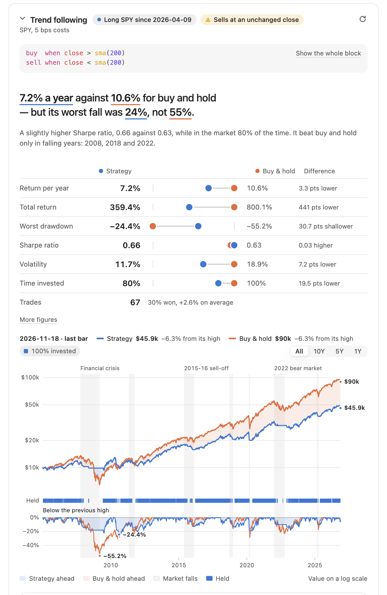
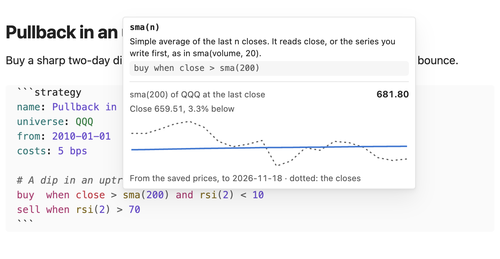
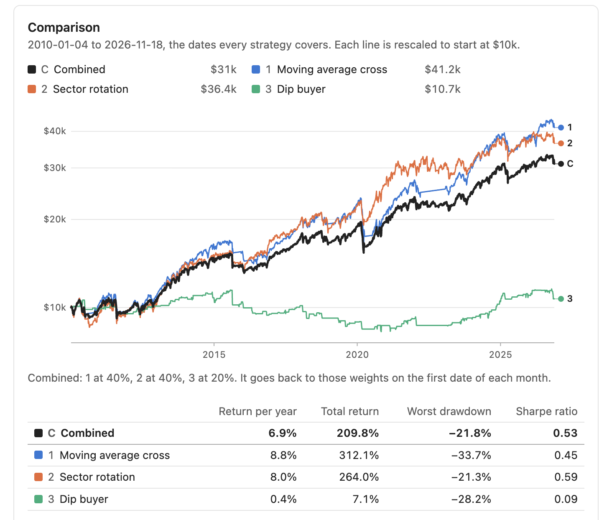

# Backtest Blocks

Test a trading strategy in an Obsidian note.

Write the rules in a `strategy` code block. The plugin runs the rules on past prices and shows the result in place of the block.

```strategy
name: Trend following
universe: SPY
from: 2005-01-01
costs: 5 bps

buy  when close > sma(200)
sell when close < sma(200)
```

This block holds SPY while SPY closes above its 200-day average, and sells when SPY closes below it. The test starts in 2005, and each trade costs 0.05%.

The note shows this:

<picture>
  <source media="(prefers-color-scheme: dark)" srcset="docs/images/result-dark.png">
  
</picture>

## What you get

- **The position now, and the next order:** one line under the title, such as "Long SPY since 2026-04-09" and "Sells unless it closes above 730.27 · 0.01% away". It shows in amber when an order is near.
- **A short verdict:** the result of the strategy, compared with buy and hold.
- **The main figures side by side:** return per year, total return, worst drawdown (the largest decrease from a peak), Sharpe ratio, volatility, time invested and trades, each with a mark that shows who did better.
- **A chart** of the strategy and buy and hold, with the large market crashes shaded. Move the pointer on a figure to see where it comes from on the chart.
- **All the trades.** Click the arrow at the start of a trade row to see why that trade occurred.
- **Tools to test the idea:** numbers that you drag in the rules, sliders, a sweep over a range of values that colours the sliders, and a **Was it luck?** check.
- **More views:** the result in each market regime and crisis, a price chart with the trades, and the values of each rule, bar by bar.

The full guide is [docs/reference.md](https://github.com/chauduyphanvu/obsidian-backtest/blob/main/docs/reference.md).

## Install

- **From Obsidian:** Settings → Community plugins → Browse, when the plugin is in the list. Before that, install it with [BRAT](https://github.com/TfTHacker/obsidian42-brat) and `chauduyphanvu/obsidian-backtest`.
- **Manual installation:** Download `main.js`, `manifest.json` and `styles.css` from the [latest release](https://github.com/chauduyphanvu/obsidian-backtest/releases). Put them in `<vault>/.obsidian/plugins/backtest-blocks/`. Then set **Backtest Blocks** to on in Community plugins.

Obsidian 1.11.4 or later is necessary. Tested on desktop (macOS). The phone layouts were examined only in the mobile emulation of Obsidian.

## Quick start

1. Open the command palette and run **Insert strategy block**. Select one of the ten starter strategies, or type a `strategy` block.
2. Move the cursor out of the block. The result shows.
3. If the plugin underlines a word, move the pointer to it to see the problem. One click corrects many problems. A block that cannot run shows its problem on its line, with a button that corrects it.
4. Drag a number in the rules, or move a slider. The result changes.

Move the pointer to a word in a block to see what it means. On an indicator, you also see its value at the last close:



## Write a strategy

A block has settings and rules. You can also add parameters and definitions. Only two items are necessary: `universe` (what to trade) and a `buy when` or `short when` rule.

```strategy
name: Three funds
universe: SPY 50%, TLT 30%, GLD 20%
from: 2010-01-01
rebalance: quarterly
costs: 5 bps
stop loss: 10%

n = 200 in 100..300 step 20

buy  when close > sma(n)
sell when close < sma(n)

for GLD:
  buy when close > sma(100) and rsi(14) < 70
```

### Settings

| To set | Write |
| --- | --- |
| What to trade, and how much of each ticker | `universe: SPY 60%, TLT 40%` |
| The dates of the test | `from: 2010-01-01` · `to: 2024-12-31` |
| A date that divides the results, to test on data that you did not use to tune the rules | `test from: 2019-01-01` |
| The source of the prices | `data: yahoo` (or `binance`, `tiingo`) |
| Bar size | `interval: 1d` (Binance has bars down to `1m`) |
| Start capital | `capital: 10k` |
| Trading costs | `costs: 5 bps` · `slippage: 2 bps` · `commission: 0.005 per share, min 1` |
| Interest on cash | `cash rate: 4%` |
| How much to invest | `size: 80%` · `weighting: inverse volatility(60)` · `risk per trade: 1% at 2 atr(14)` |
| Set the weights again on a schedule | `rebalance: monthly` |
| Buy a position in steps | `entries: 3` (with an `add when` rule) |
| Hold only the best tickers | `hold: top 3 by roc(126)` |
| Exits | `stop loss: 8%` · `trailing stop: 3 atr(14)` · `take profit: 20%` |
| When orders fill | `fill: close` (the default is the next open) · `magnify: 1h` (examine the stops in each bar) |
| Fees for shorts and for borrowed money | `borrow fee: 0.5%` · `margin rate: 6%` |
| A title, and the benchmark | `name: My strategy` · `benchmark: QQQ` |

### Rules

- `buy when` and `sell when` open and close a position. `short when` and `cover when` do the same for a short. `add when` adds to a position.
- A rule can continue on the next lines. Start each new line with `and` or `or`.
- Rules below `for TLT:` (or `for SPY, QQQ:`) apply only to those tickers. `for all:` starts the shared rules again.

### Conditions

| Write | Meaning |
| --- | --- |
| `close > sma(200)` | The close is above its 200-day average. You can also use `<` `>=` `<=` `==` `!=`, `above`, `below`. |
| `close crosses above sma(50)` | The close is above the average on this bar, and was at or below it on the previous bar. Also `crosses below`, or `crosses` for the two directions. |
| `rsi(2) between 10 and 30` | The value is from 10 to 30, with 10 and 30 included. |
| `close > sma(50) for 3 bars` | True on each of the last 3 bars. |
| `close > sma(50) within 3 bars` | True on one or more of the last 3 bars. |
| `close[1]` | The close one bar before. |
| `sma(50) of SPY` | A value from a different ticker. |

Join conditions with `and`, `or` and `not`. Use `+ - * /` and brackets for calculations.

Rules can read prices (`open`, `high`, `low`, `close`, `volume`), many indicators (for example `sma` and `rsi`), calendar values (for example `month_end`) and values of the open position (for example `bars held`). Move the pointer to a word in the editor to see what it means. The [reference](https://github.com/chauduyphanvu/obsidian-backtest/blob/main/docs/reference.md) has a list of all of them.

### Parameters

`fast = 50 in 20..100 step 10` makes a number that you can change with a slider, or by dragging it in the rules. **Try other values** runs the strategy for each value in the range:


### Definitions

`uptrend = close > sma(200)` gives a name to a condition or a number. Then use the name in rules: `buy when uptrend and rsi(2) < 10`.

### Tickers

| Write | Prices from |
| --- | --- |
| `SPY` | Yahoo Finance |
| `binance:BTCUSDT` | Binance |
| `tiingo:SPY` | Tiingo (an API key is necessary) |
| `fred:T10Y2Y` | FRED, an economic series. Read it in rules with `of`. |
| `csv:Data/gold.csv` | A CSV file in your vault |

Weights are optional. Their total can be up to 200%.

## Shorts and leverage

```strategy
name: Trend, long or short
universe: SPY
from: 2005-01-01
costs: 5 bps

buy   when close > sma(200)
short when close < sma(200)
```

- `short when` opens a short. `cover when` closes it. If a ticker has a buy rule and a short rule, one signal moves it from one side to the other.
- Weights above 100% borrow money, up to 2 times your equity, with longs and shorts together.
- Shorts pay a borrow fee: 0.5% a year by default. Borrowed money pays interest: 6% a year by default.
- If your equity decreases below 25% of your positions, a margin call closes all positions at the next open. If a run loses all its money, it stops.

A block with no short rule and weights of 100% or less does not borrow, and pays none of these fees.

## Other block types

**`compare`** shows strategies from other notes side by side. If you write weights, it also shows the strategies together and suggests how to divide money between them:

```compare
[[Trend following]] 50%
[[Pullbacks#QQQ RSI pullback]] 50%
```



**`backtests`** shows all your strategies in one table, with their figures and next orders. The command **Insert strategy dashboard** adds one:

```backtests
sort: return
```

**`account`** changes your strategies into share orders for a real account. It also compares the fills of your broker with the signals. It reads exports from Schwab, Fidelity, Interactive Brokers, or a CSV file of a different format:

```account
name: Main brokerage
holdings: SPY 120, TLT 50
cash: 4,200

[[Trend following]] 60%
[[Pullbacks#QQQ RSI pullback]] 40%
```

**Forward tests:** Click **Start a forward test** at the end of a result, or in its menu. The plugin copies the rules into a new note. After that, it counts only new prices.

## Today's orders

Run **Show today's orders**, or click its ribbon icon. The plugin runs all the strategies in your vault and shows:

- what to buy or sell at the next open or close;
- which closes to monitor, nearest first, with how near each one is;
- the orders for each account;
- the blocks that cannot run, with a button that corrects many problems.

The status bar shows the number of orders. To keep the list open while you trade, click **Keep in the sidebar**. The plugin does not place orders. You place the trades yourself.

## Commands

| Command | What it does |
| --- | --- |
| Insert strategy block | Adds one of ten starter strategies. |
| New strategy note | Makes a new note with one of the starter strategies. Works with no note open. |
| Use a CSV file in a strategy | Changes a CSV file into a ticker, a column or a small strategy. |
| Write a strategy from a description | A language model writes a strategy from plain English. First, select a provider in the settings. |
| Open strategy preview | Shows the result of the block that you edit, in the sidebar. |
| Correct the problem at the cursor | Applies the suggested correction. |
| Make the number at the cursor a parameter | Changes a number such as the 200 in `sma(200)` into a parameter with a range. |
| Insert strategy dashboard | Adds a `backtests` block. |
| Show today's orders | Opens the orders window. |
| Show today's orders in the sidebar | Keeps the list of orders open in the sidebar. |
| Save this note's results to its properties | Writes the figures of each strategy to `bt_` properties. |
| Refresh all strategies in this note | Gets new prices for every strategy in the note. |
| Fold all results in this note | Folds every result of the note to one line. |
| Open all results in this note | Opens every result of the note. |
| Refresh the strategy at the cursor | Gets new prices for the strategy that you edit. |
| Keep the strategy at the cursor as a note | Saves its result as a note. |
| Start a forward test for the strategy at the cursor | Starts a forward test of the strategy that you edit. |
| Rename the strategy at the cursor | Gives the strategy a new name. Its count of tries and the links to it stay correct. |
| Delete saved prices | Deletes the saved prices. |

## With an AI assistant

**Files for models.** Give a model [`llms.txt`](llms.txt) or [`llms-full.txt`](llms-full.txt). They contain the full language with worked examples. The `docs/` folder also has:

- `language.json`: each word and its meaning;
- `corpus/`: worked examples, and frequent errors with their corrections;
- `grammar/`: Lark and GBNF grammars, for models that generate text with a grammar.

**A command line and MCP server.** Each release includes `backtest-blocks.mjs`. It must have Node.js 20 or later. With it, an assistant can examine and run strategies outside Obsidian:

```
node backtest-blocks.mjs check note.md           # show each problem with its line; exit code 1 if there are errors
node backtest-blocks.mjs check --fix note.md     # write each correction that is the only one into the note
node backtest-blocks.mjs run note.md --block 2   # backtest one block on live prices (--json for data)
node backtest-blocks.mjs explain "stop loss"     # what a word means
node backtest-blocks.mjs mcp                     # the same, as MCP tools
```

To add it to Claude Code:

```
claude mcp add backtest-blocks -- node /path/to/backtest-blocks.mjs mcp
```

In Claude Desktop or Codex, add an MCP server with the command `node` and the arguments `/path/to/backtest-blocks.mjs mcp`.

The server has four tools: `check_strategy`, `run_backtest`, `explain_word` and `list_words`. It also gives the guide, the word list, the examples and the grammars as resources, and a `write_strategy` prompt.

`run` uses the plugin settings of the vault that holds the note, so it gives the same result as Obsidian. Prices are saved in `~/.cache/backtest-blocks`. Tiingo and FRED read their API keys from `TIINGO_API_KEY` and `FRED_API_KEY`.

## Settings

In the plugin settings, you can set:

- the default start capital, costs, slippage, commission, interest on cash, borrow fee and margin interest;
- the source of the prices for plain tickers;
- how long the plugin keeps saved prices;
- the API keys for Tiingo, FRED and the strategy writer, from the secret storage of Obsidian (the plugin does not keep the keys itself);
- if the plugin examines the orders at start-up, and if it finds tickers while you type.

## Network and privacy

The plugin connects only to these hosts:

- `query1.finance.yahoo.com` and `query2.finance.yahoo.com`: Yahoo prices, and the ticker search while you type;
- `data-api.binance.vision`: Binance prices, and its list of markets for the ticker search;
- `api.tiingo.com` and `api.stlouisfed.org`: Tiingo prices and FRED series, only with your API key;
- `api.anthropic.com`, or a server address that you enter: only when you write a strategy from a description.

The plugin sends only two types of request that you did not start. You can set each one to off in the settings: the order check some seconds after start-up, and the ticker search.

- Requests contain tickers, not the text of your notes.
- There is no telemetry, analytics or remote code.
- Prices are saved in the folder of the plugin.

The [reference shows all the requests](https://github.com/chauduyphanvu/obsidian-backtest/blob/main/docs/reference.md#network-requests).

## Limits

- A backtest on past prices does not predict the future. This is not financial advice.
- Orders fill at the next open, or at the close, with the costs, slippage and commission that you set. The plugin does not model taxes, market impact or partial fills.
- Yahoo and Tiingo adjust prices for dividends and splits. Thus, compare a price with an average of prices, not with a fixed number.
- Yahoo shows only the tickers that exist at this time. A basket of the tickers of today does not include the companies that closed. Thus, the basket looks better than it was.
- Shorts are simple: one borrow fee for all stocks. There are no hard-to-borrow lists, recalls or short-sale restrictions.
- If you test more variants on the same prices, the best variant looks better by chance. **Was it luck?** counts your tests and shows how much luck can explain.

Unit tests examine the engine with cases calculated by hand, and a second, independent backtester also examines it. The reference shows [what was examined and what was not](https://github.com/chauduyphanvu/obsidian-backtest/blob/main/docs/reference.md#how-far-to-trust-it).

## Development

```
npm install
npm test           # unit tests
npm run build      # type check, then bundle into dist/
npm run check      # all the checks that a push or a release must pass
```

The project uses Node 26. The release steps and the source layout are in the [reference](https://github.com/chauduyphanvu/obsidian-backtest/blob/main/docs/reference.md#development).

## Licence

MIT. Refer to [LICENSE](https://github.com/chauduyphanvu/obsidian-backtest/blob/main/LICENSE).
