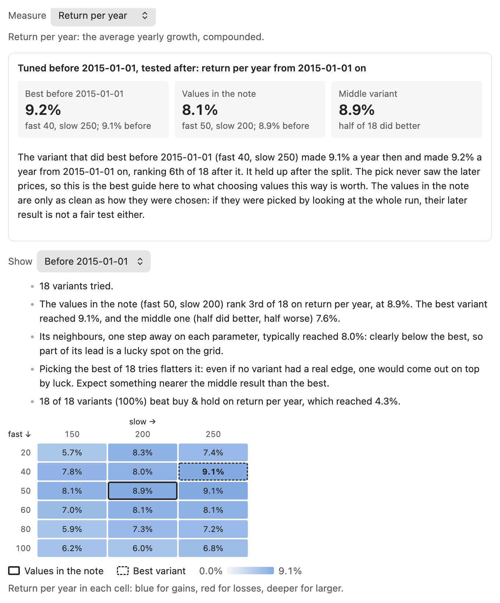

# Backtest Blocks

Test a trading strategy inside an Obsidian note.

You write the rules in a `strategy` code block. The plugin runs them on past prices and shows the results in place of the block.

```strategy
name: Trend following
universe: SPY
from: 2005-01-01
costs: 5 bps

buy  when close > sma(200)
sell when close < sma(200)
```

This block says: hold SPY while it closes above its 200-day average, and sell when it closes below it. Start in 2005, and pay 0.05% on each trade.

The note shows this:

<picture>
  <source media="(prefers-color-scheme: dark)" srcset="docs/images/result-dark.png">
  
</picture>

## What you get

- **A one-sentence verdict:** how the strategy did against simply buying and holding.
- **The main figures side by side:** return per year, total return, worst drawdown (the biggest drop from a peak), Sharpe ratio, volatility, time invested and trades.
- **A chart** of the strategy against buy and hold, with major market crashes shaded.
- **What it holds today**, and the closing price that would make it trade next.
- **Every trade.** Click **Explain this trade** to see why it happened.
- **Ways to test the idea:** sliders for parameters, a sweep that tries a range of values, and a **Was it luck?** check.
- **More views:** how it did in each market regime and crisis, a price chart with the trades, and each rule's values bar by bar.

The full guide is [docs/reference.md](https://github.com/chauduyphanvu/obsidian-backtest/blob/main/docs/reference.md).

## Install

- **From Obsidian:** Settings → Community plugins → Browse, once the plugin is listed there. Until then, install it with [BRAT](https://github.com/TfTHacker/obsidian42-brat) using `chauduyphanvu/obsidian-backtest`.
- **By hand:** download `main.js`, `manifest.json` and `styles.css` from the [latest release](https://github.com/chauduyphanvu/obsidian-backtest/releases). Put them in `<vault>/.obsidian/plugins/backtest-blocks/`. Then turn on **Backtest Blocks** under Community plugins.

Needs Obsidian 1.11.4 or later. Tested on desktop (macOS). Phone layouts have only been checked in Obsidian's mobile emulation.

## Quick start

1. Open the command palette and run **Insert strategy block**. Pick one of the ten starter strategies, or type your own `strategy` block.
2. Move the cursor out of the block. The results appear.
3. If something is underlined, hover over it to see what's wrong. Many problems have a one-click fix.
4. Change a number, or move a slider, and the results update.

Hover over any word in a block to see what it means:


## Writing a strategy

A block has settings and rules. You can also add parameters and definitions. Only two things are required: `universe` (what to trade) and a `buy when` or `short when` rule.

```strategy
name: Three funds
universe: SPY 50%, TLT 30%, GLD 20%
from: 2010-01-01
rebalance: quarterly
costs: 5 bps
stop loss: 10%

n = 200 in 100..300 step 20

buy  when close > sma(n)
sell when close < sma(n)

for GLD:
  buy when close > sma(100) and rsi(14) < 70
```

### Settings

| To set | Write |
| --- | --- |
| What to trade, and how much of each | `universe: SPY 60%, TLT 40%` |
| The dates to test | `from: 2010-01-01` · `to: 2024-12-31` |
| A date to split the results at, to test on data you didn't tune on | `test from: 2019-01-01` |
| Where prices come from | `data: yahoo` (or `binance`, `tiingo`) |
| Bar size | `interval: 1d` (Binance goes down to `1m`) |
| Starting money | `capital: 10k` |
| Trading costs | `costs: 5 bps` · `slippage: 2 bps` · `commission: 0.005 per share, min 1` |
| Interest earned on cash | `cash rate: 4%` |
| How much to invest | `size: 80%` · `weighting: inverse volatility(60)` · `risk per trade: 1% at 2 atr(14)` |
| Reset the weights on a schedule | `rebalance: monthly` |
| Build a position in steps | `entries: 3` (with an `add when` rule) |
| Hold only the best few tickers | `hold: top 3 by roc(126)` |
| Exits | `stop loss: 8%` · `trailing stop: 3 atr(14)` · `take profit: 20%` |
| When orders fill | `fill: close` (the default is the next open) · `magnify: 1h` (check stops inside each bar) |
| Fees for shorting and borrowing | `borrow fee: 0.5%` · `margin rate: 6%` |
| A title, and what to compare with | `name: My strategy` · `benchmark: QQQ` |

### Rules

- `buy when` and `sell when` open and close a position. `short when` and `cover when` do the same for a short. `add when` adds to a position.
- A rule can go on over several lines. Start each new line with `and` or `or`.
- Rules under `for TLT:` (or `for SPY, QQQ:`) apply only to those tickers. `for all:` goes back to the shared rules.

### Conditions

| Write | Meaning |
| --- | --- |
| `close > sma(200)` | The close is above its 200-day average. Also `<` `>=` `<=` `==` `!=`, `above`, `below`. |
| `close crosses above sma(50)` | The close is above the average now, and was at or below it on the bar before. Also `crosses below`, or `crosses` for either way. |
| `rsi(2) between 10 and 30` | The value is from 10 to 30, both included. |
| `close > sma(50) for 3 bars` | True on each of the last 3 bars. |
| `close > sma(50) within 3 bars` | True on at least one of the last 3 bars. |
| `close[1]` | The close one bar ago. |
| `sma(50) of SPY` | A value from another ticker. |

Join conditions with `and`, `or` and `not`. Do math with `+ - * /` and brackets.

Rules can read prices (`open`, `high`, `low`, `close`, `volume`), dozens of indicators such as `sma` and `rsi`, calendar values such as `month_end`, and the open position, such as `bars held`. Hover over a word in the editor to see what it means. The [reference](https://github.com/chauduyphanvu/obsidian-backtest/blob/main/docs/reference.md) lists them all.

### Parameters

`fast = 50 in 20..100 step 10` makes a number you can change with a slider. **Try other parameter values** runs the strategy for every value in the range:



### Definitions

`uptrend = close > sma(200)` gives a condition or a number a name. Then use the name in rules: `buy when uptrend and rsi(2) < 10`.

### Tickers

| Write | Prices from |
| --- | --- |
| `SPY` | Yahoo Finance |
| `binance:BTCUSDT` | Binance |
| `tiingo:SPY` | Tiingo (needs an API key) |
| `fred:T10Y2Y` | FRED, an economic series. Read it in rules with `of`. |
| `csv:Data/gold.csv` | A CSV file in your vault |

Weights are optional. They can add up to 200%.

## Shorts and leverage

```strategy
name: Trend, long or short
universe: SPY
from: 2005-01-01
costs: 5 bps

buy   when close > sma(200)
short when close < sma(200)
```

- `short when` opens a short. `cover when` closes it. With both a buy rule and a short rule, a ticker switches sides on one signal.
- Weights above 100% borrow money, up to 2 times your equity, counting longs and shorts together.
- Shorts pay a borrow fee: 0.5% a year by default. Borrowed money pays interest: 6% a year by default.
- If your equity falls below 25% of your positions, a margin call closes everything at the next open. If a run loses all its money, it stops.

A block with no short rule and weights of 100% or less never borrows, and pays none of these fees.

## Other block types

**`compare`** shows strategies from other notes side by side. With weights, it also draws them combined and suggests how to split money between them:

```compare
[[Trend following]] 50%
[[Pullbacks#QQQ RSI pullback]] 50%
```


**`backtests`** lists all your strategies in one table, with their figures and next orders. The command **Insert strategy dashboard** adds one:

```backtests
sort: return
```

**`account`** turns your strategies into share orders for a real account. It also compares your broker's fills with the signals. It reads exports from Schwab, Fidelity, Interactive Brokers, or any CSV:

```account
name: Main brokerage
holdings: SPY 120, TLT 50
cash: 4,200

[[Trend following]] 60%
[[Pullbacks#QQQ RSI pullback]] 40%
```

**Forward tests:** click **Start a forward test** under a result. It copies the rules into a new note and from then on counts only new prices.

## Today's orders

Run **Show today's orders**, or click its ribbon icon. It runs every strategy in your vault and lists:

- what to buy or sell at the next open or close;
- which closing prices to watch;
- the orders for each account.

The status bar shows how many orders there are. The plugin never places orders. You place trades yourself.

## Commands

| Command | What it does |
| --- | --- |
| Insert strategy block | Adds one of ten starter strategies. |
| Use a CSV file in a strategy | Turns a CSV file into a ticker, a column or a small strategy. |
| Draft a strategy from a description | A language model writes a strategy from plain English. Choose a provider in the settings first. |
| Open strategy preview | Shows the result of the block you're editing in the sidebar. |
| Fix the problem at the cursor | Applies the suggested fix. |
| Insert strategy dashboard | Adds a `backtests` block. |
| Show today's orders | Opens the orders window. |
| Save this note's results to its properties | Writes each strategy's figures to `bt_` properties. |
| Clear saved prices | Deletes the saved prices. |

## With an AI assistant

**Files for models.** Point a model at [`llms.txt`](llms.txt) or [`llms-full.txt`](llms-full.txt). They hold the whole language with worked examples. The `docs/` folder also has:

- `language.json`: every word and what it means;
- `corpus/`: worked examples, and common mistakes with their fixes;
- `grammar/`: Lark and GBNF grammars, for models that generate under a grammar.

**A command line and MCP server.** Each release includes `backtest-blocks.mjs`. It needs Node.js 20 or later. With it, an assistant can check and run strategies outside Obsidian:

```
node backtest-blocks.mjs check note.md           # list each problem with its line; exit 1 on errors
node backtest-blocks.mjs run note.md --block 2   # backtest one block on live prices (--json for data)
node backtest-blocks.mjs explain "stop loss"     # what a word means
node backtest-blocks.mjs mcp                     # the same, as MCP tools
```

To add it to Claude Code:

```
claude mcp add backtest-blocks -- node /path/to/backtest-blocks.mjs mcp
```

In Claude Desktop or Codex, add an MCP server with the command `node` and the arguments `/path/to/backtest-blocks.mjs mcp`.

The server has four tools: `check_strategy`, `run_backtest`, `explain_word` and `list_words`. It also offers the guide, word list, examples and grammars as resources, and a `write_strategy` prompt.

Prices are saved in `~/.cache/backtest-blocks`. Tiingo and FRED read their API keys from `TIINGO_API_KEY` and `FRED_API_KEY`.

## Settings

In the plugin settings you can set:

- default starting money, costs, slippage, commission, interest on cash, borrow fee and margin interest;
- where plain tickers get their prices;
- how long saved prices are kept;
- API keys for Tiingo, FRED and drafting, picked from Obsidian's secret storage (the plugin never stores them itself);
- whether to check orders at start-up and look up tickers while you type.

## Network and privacy

The plugin contacts only these hosts:

- `query1.finance.yahoo.com` and `query2.finance.yahoo.com`: Yahoo prices, and the ticker lookup while you type;
- `data-api.binance.vision`: Binance prices, and its list of markets for the ticker lookup;
- `api.tiingo.com` and `api.stlouisfed.org`: Tiingo prices and FRED series, only with your API key;
- `api.anthropic.com`, or a server address you enter: only when you draft a strategy.

It makes only two kinds of request without you asking, and you can turn each one off in the settings: the order check a few seconds after start-up, and the ticker lookup.

- Requests carry tickers, never the text of your notes.
- There is no telemetry, analytics or remote code.
- Prices are saved in the plugin's folder.

The [reference lists every request](https://github.com/chauduyphanvu/obsidian-backtest/blob/main/docs/reference.md#network-requests).

## Limits

- A backtest on past prices doesn't predict the future. This is not financial advice.
- Orders fill at the next open, or at the close, with the costs, slippage and commission you set. Taxes, market impact and partial fills are not modelled.
- Yahoo and Tiingo prices are adjusted for dividends and splits. So compare a price with an average of prices, not with a fixed number.
- Yahoo only lists tickers that still exist. A basket of today's tickers leaves out the companies that failed, so it looks better than it really was.
- Shorts are kept simple: one borrow fee for every stock. There are no hard-to-borrow lists, recalls or short-sale restrictions.
- The more variants you try on the same prices, the better the best one looks by chance. **Was it luck?** counts your tries and shows how much luck could explain.

The engine is checked by unit tests with cases worked out by hand, and against a second, independent backtester. The reference says [what has and hasn't been checked](https://github.com/chauduyphanvu/obsidian-backtest/blob/main/docs/reference.md#how-far-to-trust-it).

## Development

```
npm install
npm test           # unit tests
npm run build      # type check, then bundle into dist/
npm run check      # everything a push or release must pass
```

Developed with Node 26. Release steps and the source layout are in the [reference](https://github.com/chauduyphanvu/obsidian-backtest/blob/main/docs/reference.md#development).

## Licence

MIT. See [LICENSE](https://github.com/chauduyphanvu/obsidian-backtest/blob/main/LICENSE).
